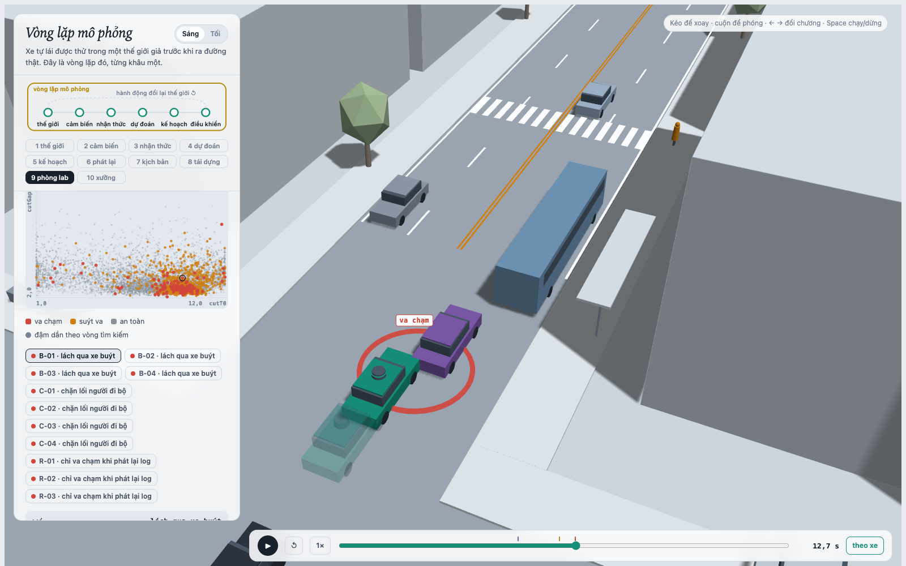
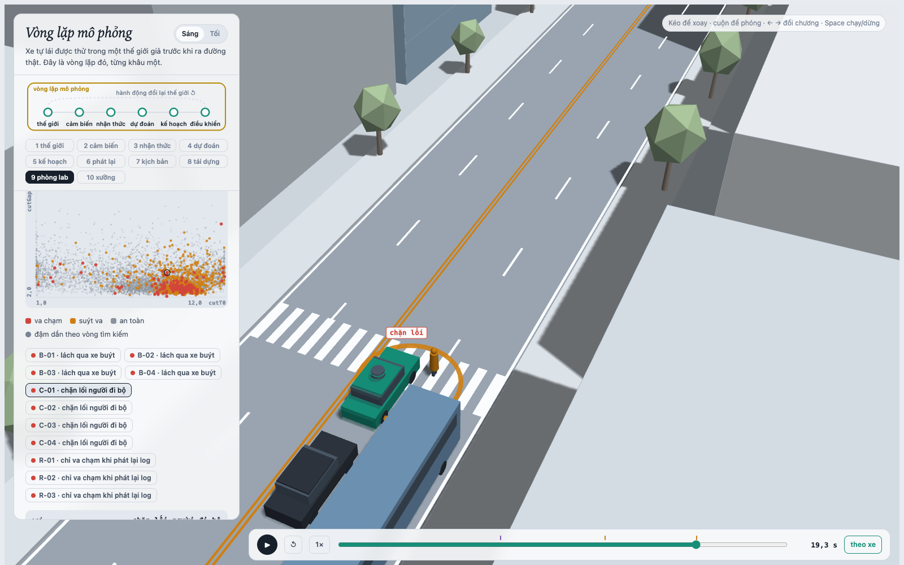
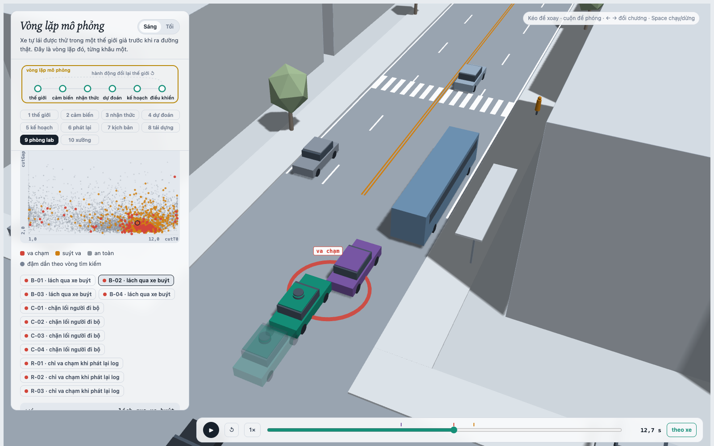
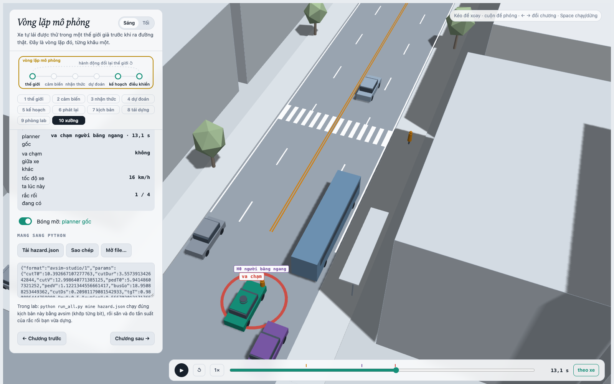

MSSV: 2202602928

# Lab 11 · Scenario Forge — báo cáo

Mỗi câu: trả lời ngắn, **trích số từ `evidence/`** (ghi tên file và trường, ví dụ `mc.json: crashes = 4`). Grader chạy lại với MSSV của bạn; số không khớp `evidence/` thì mất điểm phần D (RUBRIC), và câu dựa trên số sai khó được điểm đầy đủ. Không cần văn hay: một bảng nhỏ và hai, ba câu giải thích là đủ.

Thị trấn của bạn (`meta.json: _run.town`): **A** (`meta.json: _run.quick = false`, mọi bước chạy bằng ngân sách đầy đủ)

## 1. Phát lại log có trung thực không? (bước A)

| `replay.json` | Số |
|---|---|
| `n` kịch bản | 400 |
| `dropped_human_crash_logs` (log có người lái va chạm, bị bỏ) | 0 |
| `n_used` | 400 |
| Planner trên **log phát lại** (`replay.crashes`) | **124**: `rear` 114, `side` 10 |
| Planner trong **thế giới phản ứng** (`reactive.crashes`) | **0** |
| Va chạm ở cả hai (`crash_in_both`) | 0 |

Gần như mọi va chạm của "phát lại" là `rear` (114/124): planner **thận trọng hơn** người lái trong log (T = 1,6 s thay vì 1,1 s, chạy chậm `cautionV` khi tới gần vạch bị xe buýt che), nên ở cùng thời điểm nó chậm hơn và lùi phía sau chỗ người lái đã ở. Xe bám đuôi TG trong log phát lại **không biết** planner phanh sớm hơn người lái: nó chỉ chạy lại đúng quỹ đạo đã ghi, cứ thế lao vào đuôi xe ta. Đó là va chạm **giả** (`fake: true`): trong thế giới phản ứng TG lái theo IDM, thấy xe ta chậm lại thì phanh, và số va chạm là 0. Cả 124 va chạm đều chỉ có ở phát lại (`crash_in_both = 0`).

**Ví dụ, `replay_only[0]` (kịch bản 0, `contact: rear`, `min_ttc_reactive = 2,50 s`).** Trong log, người lái giữ khoảng 10–11 m/s và ở t = 17,65 s đã tới x ≈ 153 m. Planner chạy trên cùng log thì giảm tốc khi tới gần xe buýt / vạch qua đường và gần như dừng ở x ≈ 114 m (0,5 m/s). TG phát lại vẫn chạy 4,1 m/s tới x ≈ 110 m như trong log và tông vào đuôi xe ta lúc t = 17,65 s. Trong thế giới phản ứng, cùng lúc đó TG ở x ≈ 102 m, cách xe ta khoảng 12 m và đang phanh: TTC nhỏ nhất 2,5 s, không va chạm. (Phần mô tả quỹ đạo lấy từ một lần chạy lại kịch bản này bằng `avsim`, không có sẵn trong `evidence/`.)

## 2. Kịch bản bất khả thi (bước B)

Luật trong `is_feasible` (`lab11/feasible.py`), với μ = `mu` (0,8 khô, 0,5 ướt), g = 9,81 m/s²:

| Luật | Căn cứ vật lý |
|---|---|
| a_lat = (π / `cutDur`)² · 3,5 / 2 ≤ μg | Chuyển làn 3,5 m theo đường cosin trong `cutDur` s cần gia tốc ngang đỉnh như vậy; lốp không tạo được lực ngang quá μ·m·g, nên xe sẽ trượt. Trên đường ướt (μg = 4,9 m/s²) mọi lần chuyển làn ngắn hơn ≈ 1,88 s là không thể. |
| `cutBrake` ≤ μg | Gia tốc phanh dọc cũng bị giới hạn bởi ma sát lốp–mặt đường. |
| `pedV` ≤ 2,5 m/s | Tốc độ đi bộ thường 1,2–1,5 m/s; 2,5 m/s đã là chạy, không còn là "người đi bộ qua đường" của mô hình. |
| 0 < `cutV` ≤ 22 m/s | Xe chuyển làn phải đang chạy tới, và không vượt xa tốc độ của con phố đô thị (22 m/s ≈ 80 km/h). |

Kịch bản bất khả thi bị bỏ qua trong `hunt.json: infeasible`: `rear_ended` **5** (nhiều nhất), `cut_in` 4, `crosswalk_block` 4, `bus_bypass` 1. `mc.json: infeasible` = 18 trên 3 000.

Vì sao CEM bị kéo về đó: điểm nguy hiểm của `cut_in` và `rear_ended` là TTC, và cách "dễ" nhất để TTC nhỏ là một xe chuyển làn **rất gắt** (`cutDur` ngắn, `cutV` cao) **trên đường ướt**: đề xuất cuối của hai cuộc săn đó đẩy xác suất đường ướt lên `p_bin[wet]` = 0,95 (`cut_in`) và 0,77 (`rear_ended`) so với 0,20 tự nhiên (`hunt.json: <kiểu>.proposal.p_bin[0]`). Mà đường ướt hạ μg xuống 4,9 m/s², đúng là lúc luật ma sát ngang loại kịch bản. Những kịch bản bất khả thi là "nguy hiểm nhất" chính vì chúng không thể xảy ra. Nếu **đếm** chúng là va chạm, chúng sẽ có điểm cao nhất, lọt vào elite, CEM hội tụ về vùng bất khả thi, và ước lượng IS sẽ cộng xác suất của những va chạm vật lý không cho phép: con số bị **thổi phồng**, và các "kiểu thất bại" tìm được là ảo.

## 3. Monte Carlo cho bạn biết gì (bước C1)

`mc.json`: **k = 5**, **n = 3 000**, **p̂ = 1,67·10⁻³**, Wilson 95 % **[7,12·10⁻⁴, 3,90·10⁻³]**. Cả 5 vụ đều là `bus_bypass` (`mc.json: modes`). 18 kịch bản bất khả thi không được chạy hay đếm (`mc.json: infeasible`).

Để khoảng tin cậy còn ±20 % của p: 1,96·√(p(1−p)/n) = 0,2·p ⇒ n = 1,96²·(1−p) / (0,04·p) ≈ 96/p ≈ **57 500 lần chạy** (≈ 19 lần ngân sách hiện tại).

Các kiểu **chưa xuất hiện** trong 3 000 lần: `cut_in`, `crosswalk_block`, `rear_ended`, `other` (k = 0 cho mỗi kiểu, `mc.json: per_mode`). Không được báo 0: con số đúng là **cận trên Wilson 95 % = 1,28·10⁻³** cho mỗi kiểu (`per_mode.<kiểu>.hi`; quy tắc 3/n cho 1,0·10⁻³, cùng cỡ). Tức là MC chỉ nói được "dưới khoảng 1 trên 800 chuyến", không nói được "không bao giờ".

## 4. Importance sampling, ESS và độ suy biến (bước C3)

`estimate.json`, mỗi seed n = 600 mẫu cho mỗi kiểu:

| seed | kiểu | `p` | khoảng ±1,96·se | `hits` | `ess` | `top_share` | `upper_zero_hits` |
|---|---|---|---|---|---|---|---|
| 0 | `bus_bypass` | 1.30e-03 | [1.23e-04, 2.47e-03] | 28 | 138 | 0.39 | — |
| 0 | `cut_in` | 0 | — | 0 | 116 | 0 | 0.025 |
| 0 | `crosswalk_block` | 2.52e-06 | [0, 5.80e-06] | 75 | 132 | **0.65** | — |
| 0 | `rear_ended` | 0 | — | 0 | 131 | 0 | 0.025 |
| 0 | **total** | **1.30e-03** | [1.25e-04, 3.75e-03] | | | | |
| 1 | `bus_bypass` | 5.64e-03 | [0, 1.31e-02] | 31 | 128 | **0.65** | — |
| 1 | `cut_in` | 0 | — | 0 | 119 | 0 | 0.025 |
| 1 | `crosswalk_block` | 7.21e-07 | [8.50e-08, 1.36e-06] | 61 | 128 | 0.31 | — |
| 1 | `rear_ended` | 0 | — | 0 | 114 | 0 | 0.025 |
| 1 | **total** | **5.64e-03** | [0, 1.44e-02] | | | | |
| 2 | `bus_bypass` | 3.98e-04 | [1.54e-04, 6.42e-04] | 28 | 132 | 0.17 | — |
| 2 | `cut_in` | 0 | — | 0 | 108 | 0 | 0.025 |
| 2 | `crosswalk_block` | 4.81e-07 | [1.03e-07, 8.59e-07] | 54 | 119 | 0.37 | — |
| 2 | `rear_ended` | 0 | — | 0 | 135 | 0 | 0.025 |
| 2 | **total** | **3.99e-04** | [1.55e-04, 1.92e-03] | | | | |

`other` (`estimate.json: other`): k = 0 trên n = 3 000, p = 0, cận trên 1,28·10⁻³, `source: mc.json`.

**Các seed có đồng ý không?** Không hẳn: tổng chênh nhau **14 lần** (3,99·10⁻⁴ đến 5,64·10⁻³). Trung vị 1,30·10⁻³ nằm trong khoảng Wilson của MC [7,12·10⁻⁴, 3,90·10⁻³], nhưng seed 1 nằm trên cận trên của MC và seed 2 dưới cận dưới. `crosswalk_block` chênh 5 lần giữa các seed (4,8·10⁻⁷ đến 2,5·10⁻⁶), và MC (0/3 000, cận trên 1,28·10⁻³) không mâu thuẫn với con số đó nhưng cũng không kiểm chứng được nó.

**`top_share` > 0,5:** seed 1 `bus_bypass` (0,65) và seed 0 `crosswalk_block` (0,65). Ở seed 1, một mẫu duy nhất mang 65 % của p = 5,64·10⁻³: trọng số của nó w ≈ 0,65 × 5,64·10⁻³ × 600 ≈ 2,2, gần một mẫu "tự nhiên" (rút từ phần 0,2·p của hỗn hợp, w ≤ 1/β = 5) chứ không phải mẫu từ đề xuất CEM (w rất nhỏ). Bỏ mẫu đó đi thì ước lượng còn khoảng 2·10⁻³, gần các seed khác. Khi đó con số thực chất chỉ là "trọng số của một mẫu chia cho 600", và khoảng ±1,96·se (ở đây kéo xuống tận 0) không đáng tin. Ngược lại, `top_share` thấp không chứng minh ước lượng đúng: `crosswalk_block` seed 1 có `top_share` 0,31 nhưng vẫn có thể thấp hơn sự thật nhiều lần nếu q bỏ sót cả một vùng va chạm (bẫy 3).

**Ngân sách:** `budget` = **16 800** lần chạy (4 cuộc săn × 8 vòng × 300 + 3 seed × 4 kiểu × 600). Số lần chạy MC cần để có cùng sai số tương đối (n = (1−p)/(p·(se/p)²)):

| kiểu, seed | p | se/p | MC cần |
|---|---|---|---|
| `bus_bypass`, 0 | 1,30·10⁻³ | 0,46 | ≈ 3 600 |
| `bus_bypass`, 2 | 3,98·10⁻⁴ | 0,31 | ≈ 25 700 |
| `crosswalk_block`, 1 | 7,21·10⁻⁷ | 0,45 | ≈ 6,8·10⁶ |
| `crosswalk_block`, 2 | 4,81·10⁻⁷ | 0,40 | ≈ 1,3·10⁷ |

Với `bus_bypass` (p ≈ 10⁻³) IS **không** hơn MC đáng kể: 3 000 lần MC đã cho se/p ≈ 1/√5 ≈ 0,45, cùng cỡ một seed IS. IS chỉ thắng lớn ở kiểu thật sự hiếm: với `crosswalk_block`, MC cần 10⁶–10⁷ lần chạy, gấp 400–800 lần ngân sách IS (nếu tin con số IS, xem bẫy 3 ở câu 5).

**Phần `other`** lấy từ Monte Carlo C1 (`mc.json`, 0/3 000) vì không cuộc săn nào nhắm vào nó: `other` là "mọi thứ còn lại", không có một điểm nguy hiểm liên tục nào để CEM leo lên, và săn nó sẽ chỉ kéo q về một trong các kiểu đã có.

## 5. Các kiểu thất bại (bước C2 + 3D)

| Kiểu | Tìm thấy ở | Chuỗi sự kiện (theo trình xem, chương 9) |
|---|---|---|
| `bus_bypass` | cuộc săn `bus_bypass`: 105 (`hunt.json: bus_bypass.found`); MC: 5/5 vụ | C2 (xe tím) kẹt sau xe buýt đỗ ở làn ngoài, lách ra làn xe ta để vượt xe buýt rồi gần như dừng (0 m/s, x ≈ 96 m); xe ta (xe xanh) chỉ coi C2 là xe phía trước khi C2 đã vào gần hết làn (ngưỡng ngang `cutinLat` = 2,15 m), phanh không kịp và đâm vào đuôi C2 ở 4,0 m/s (`contact = front`). |
| `crosswalk_block` | cuộc săn `crosswalk_block`: 29 (`hunt.json: crosswalk_block.found`) | P1 bước xuống lòng đường ngay trước đầu xe buýt; xe buýt nằm ngay cạnh xe ta nên che tầm nhìn tới P1 đến khi đã gần; xe ta phanh gấp và dừng hẳn (0 m/s), nhưng thân xe nằm trên vạch qua đường, P1 phải đứng lại (`kind == "block"`). |

*`bus_bypass`, B-01, t = 12,7 s (đường ướt, μ 0,5).*

*`crosswalk_block`, C-01, t = 19,3 s (đường ướt, μ 0,5).*

**Không tìm thấy:** `cut_in` và `rear_ended`. Cuộc săn `cut_in` chỉ ra `{'bus_bypass': 46, 'crosswalk_block': 2}`, cuộc săn `rear_ended` ra `{'bus_bypass': 7, 'crosswalk_block': 6}`: không có vụ nào đúng kiểu của mình, và IS cho 0 hit ở cả 3 seed. Mức tin: chỉ là cận trên. IS cho `upper_zero_hits` = 0,025 (yếu), MC cho Wilson ≤ 1,28·10⁻³. Tức là hai kiểu này **hiếm hơn khoảng 10⁻³**, không phải "không xảy ra"; điểm nguy hiểm (TTC) của chúng dừng ở mức −3,3 và −1,2 (`hunt.json: <kiểu>.proposal.level`), nghĩa là cuộc săn tiến gần nhưng chưa chạm.

**Nếu chỉ săn chung một cuộc:** nhìn `found` của từng cuộc săn, mọi cuộc săn không nhắm `crosswalk_block` đều trôi về `bus_bypass` (chỗ va chạm dễ nhất): `cut_in` ra 46 vụ `bus_bypass`, `rear_ended` ra 7. `crosswalk_block` chỉ xuất hiện đáng kể (29 vụ) trong cuộc săn riêng của nó, còn cuộc săn `bus_bypass` chỉ thấy 1. Một cuộc săn chung sẽ co về `bus_bypass` và bỏ sót `crosswalk_block` (bẫy 1), nên mỗi kiểu cần một cuộc săn với điểm nguy hiểm riêng.

## 6. Sửa planner (bước E + 3D)

Policy được chọn (`fix.json: chosen.policy`): **`cutinLat` 2,6, `cautionV` 7,0, `pedBuffer` 3,5** (gốc: 2,15 / 7,5 / 2,5). Chọn bằng `choose_policy` trên **TRAIN**; con số báo cáo là TEST.

| | `fail` | `fail_hi_seen` | `fail_hi` (hợp lệ) | `unseen` | quãng đường (m) | phanh gấp (khung/kịch bản) |
|---|---|---|---|---|---|---|
| Gốc, TRAIN (`baseline_train`) | 5,40·10⁻⁴ | 1,08·10⁻³ | 1,08·10⁻³ | — | 216,5 | 7,88 |
| Bản sửa, TRAIN (`chosen`) | 4,90·10⁻⁵ | 1,34·10⁻⁴ | 1,34·10⁻⁴ | `bus_bypass` | 210,0 | 9,12 |
| Gốc, **TEST** (`baseline_test`) | 3,55·10⁻⁴ | 6,51·10⁻⁴ | 1,93·10⁻³ | — | 215,0 | 8,38 |
| Bản sửa, **TEST** (`chosen_test`) | **1,69·10⁻⁵** | **4,74·10⁻⁵** | **3,88·10⁻²** | `bus_bypass` | **207,0** (−3,7 %) | 9,14 |

Trên TEST, bản sửa giảm `fail` khoảng 21 lần và `fail_hi_seen` khoảng 14 lần, mất 3,7 % quãng đường (trong giới hạn 5 %), đổi lại phanh gấp nhiều hơn một chút (9,14 so với 8,38).

**Vì sao `fail_hi` của bản sửa (3,88·10⁻²) lớn hơn cả `fail` của policy gốc:** cuộc săn mới trên TEST không tìm thấy vụ `bus_bypass` nào cho bản sửa (`unseen: ['bus_bypass']`), nên kiểu đó được cộng cận trên `upper_zero_hits` = 3/(0,2·400) = 0,0375. Cộng với `crosswalk_block` (4,74·10⁻⁵) và va chạm khác trên tập tự nhiên (0/3 000, cận 1,28·10⁻³) ra 0,0388. Đó là giới hạn của ngân sách n = 400, không phải bằng chứng bản sửa tệ hơn: để chứng nhận một kiểu đã biến mất dưới 10⁻³ cần khoảng 15 000 lần chạy trên đúng chỗ đó.

*B-02, t = 12,7 s. Kịch bản này được tìm dưới policy gốc, nên trong trình xem xe ta **đặc** chạy policy gốc (va chạm C2) và **bóng mờ** là bản sửa. Bóng mờ vẫn cách C2 một khoảng an toàn phía sau: với `cutinLat` = 2,6 m, bản sửa nhận C2 là xe phía trước sớm hơn, khi C2 mới bắt đầu lấn sang, nên phanh kịp. Bản sửa tránh được cả 4 vụ `bus_bypass` đã lưu (B-01 đến B-04) và 2/4 vụ `crosswalk_block` (C-02, C-04), theo một lần chạy lại các kịch bản này bằng `avsim`.*

**Núm "nghe thì an toàn hơn" nhưng phản tác dụng** (số TRAIN, `fix.json: table`, so với gốc `fail` 5,40·10⁻⁴, `fail_hi` 1,08·10⁻³):

- `T` = 2,0 (giữ khoảng cách xa hơn): `fail` 7,34·10⁻⁴, `fail_hi` 1,52·10⁻³; `bus_bypass` tăng từ 3,61·10⁻⁴ lên 5,54·10⁻⁴.
- `cautionV` = 6,5 (chạy chậm hơn gần vạch bị che): `fail` 6,23·10⁻⁴, `fail_hi` 1,23·10⁻³; `bus_bypass` lên 5,74·10⁻⁴.

Thế giới phản ứng lại: C2 chấp nhận một khe khi nó đủ rộng (*gap acceptance*). Xe ta để khoảng trống lớn hơn hoặc chậm lại cạnh xe buýt thì tạo ra đúng cái khe đó, nên C2 lách ra làn xe ta thường hơn, ngay chỗ xe ta đang đi qua. An toàn hơn cho xe ta "trong chân không" lại mời xe khác vào. (Giải thích này là giả thuyết; xác nhận bằng cách mở một vụ `bus_bypass` của `T` = 2,0 trong trình xem.) Bản sửa được chọn thắng vì `cutinLat` 2,6 cho xe ta nhận C2 là xe phía trước sớm hơn khi C2 mới bắt đầu lấn sang, thay vì đi chậm chung chung.

## 7. Từ mô phỏng ra đường thật

Ba giả định chọn theo chỗ các va chạm tập trung trong các điểm đã thử (`viewer.json: cloud`, 6 000 điểm của các cuộc săn; số dưới đây là trung vị/trung bình tôi tính từ đó):

| Giả định trong `space.py` | Vì sao ảnh hưởng nhiều | Dữ liệu thật để thay, lấy từ đâu | Nếu sai thì con số sai theo hướng nào |
|---|---|---|---|
| **Khe chấp nhận của xe chuyển làn** `cutGap` ~ lognormal, trung vị 12 m (thị trấn A), σ 0,5; cùng thời gian chuyển làn `cutDur` (trung vị 4 s) | 106 vụ `bus_bypass` trong cloud có `cutGap` trung vị **6,3 m**, so với 9,4 m của mọi điểm đã thử: `bus_bypass` (kiểu chiếm gần hết tổng 1,30·10⁻³) sống ở đuôi khe nhỏ. | Quỹ đạo xe từ drone/camera cố định đã gắn nhãn: highD/inD (Đức), NGSIM US-101/I-80 (Mỹ), Waymo Open Motion / Argoverse 2 (đô thị). Tốt nhất: tự quay drone ở vài điểm dừng xe buýt trong thành phố, đo khe mà xe vượt xe buýt chấp nhận khi lấn sang làn bên. | Giao thông đô thị đông (nhiều xe máy, lấn làn quen tay) gần như chắc chắn chấp nhận khe **nhỏ hơn** 12 m. Khi đó đuôi khe nhỏ dày hơn, nên P(`bus_bypass`) và tổng của tôi bị **đánh giá thấp**. |
| **Người đi bộ có ngó qua xe buýt không** `pedLook` ~ Bernoulli(0,85), cùng khe thời gian họ chấp nhận `pedGap` (trung vị 4,5 s) | Trong 25 vụ `crosswalk_block` của cloud, chỉ **12 %** có `pedLook` = 1 (so với 85 % tự nhiên), và `pedGap` trung vị **2,2 s** so với 3,8 s chung: kiểu này gần như chỉ xảy ra khi người đi bộ bước ra mù. | Quan sát tại vạch qua đường cạnh điểm dừng xe buýt (video, đếm tay hoặc bằng bộ phát hiện người): tỉ lệ người dừng nhìn trước khi bước qua đầu xe buýt, khe thời gian khi bước xuống. Bộ dữ liệu có sẵn: inD (người đi bộ ở nút giao, quay bằng drone), [PIE](https://www.paperswithcode.com/paper/pie-a-large-scale-dataset-and-models-for) / JAAD (ý định băng qua, nhìn từ camera trên xe), và [IDD-PeD](https://arxiv.org/abs/2506.22111) cho giao thông hỗn hợp, không theo làn, gần với đường phố Việt Nam hơn. Một nghiên cứu quan sát ở Utah ([arXiv 2408.08890](https://arxiv.org/abs/2408.08890)) đã đo đúng loại hành vi này quanh xe buýt: 0,9 % hành khách băng qua ngay sau đuôi xe, 0,45 % ngay trước đầu xe. | Nếu thật ra ít người ngó hơn 85 % hoặc chấp nhận khe ngắn hơn, `crosswalk_block` (IS ≈ 5·10⁻⁷ đến 2,5·10⁻⁶) bị **đánh giá thấp**, có thể nhiều bậc độ lớn vì nó nằm ở đuôi của cả hai biến cùng lúc. |
| **Mặt đường ướt**: Bernoulli(0,20), và ma sát chỉ có hai giá trị μ = 0,8 (khô) / 0,5 (ướt) | Cả 25 vụ `crosswalk_block` trong cloud đều ở μ = 0,5 (trung bình μ = 0,50), và cuộc săn `crosswalk_block` đẩy `p_bin[wet]` lên 0,94 (`hunt.json`). Quãng phanh tỉ lệ với 1/μ, nên chỉ đường ướt mới làm xe ta dừng muộn đến mức nằm trên vạch. | Tỉ lệ giờ mưa theo mùa từ trạm khí tượng gần nhất (trọng số theo giờ có xe chạy, không theo ngày); hệ số bám đo bằng xe đo ma sát (SCRIM, GripTester) của đơn vị quản lý đường, hoặc thử phanh ABS trên đúng đoạn đường. | Ở khí hậu nhiệt đới, mùa mưa có tỉ lệ đường ướt cao hơn 20 %, và μ thật là một phân bố (nước đọng, sơn vạch kẻ, lốp mòn có thể xuống 0,3–0,4). Cả hai đều làm `crosswalk_block` bị **đánh giá thấp**. Ngược lại, mô hình bỏ qua việc tài xế (và xe khác) tự chạy chậm khi trời mưa, làm con số **cao lên** một phần; hướng ròng cần dữ liệu tốc độ khi mưa để biết. |

Điểm chung: cả ba lỗi đều nằm ở **đuôi** phân phối, đúng chỗ dữ liệu thật thưa nhất. Một phân phối khớp tốt ở trung vị vẫn có thể sai xác suất va chạm nhiều lần.

## 8. Giới hạn

Xác suất tôi báo là "P(thất bại) trong một lần chạy 24 s của **đúng cảnh này** dưới phân phối giả định của thị trấn A". Nó **không** nói:

1. **Bất cứ điều gì ngoài một con phố này.** Thế giới chỉ có một đoạn đường, một xe buýt đỗ trước một vạch qua đường, một xe chuyển làn C2, một người đi bộ P1 băng qua và một xe bám đuôi TG, với dàn diễn viên cố định. Không có xe máy, xe đạp, nút giao có đèn, xe ngược chiều lấn làn hay đỗ trái phép. Con số 1,30·10⁻³ là trên mỗi lần chạy cảnh này, không phải trên mỗi km hay mỗi chuyến: muốn đổi ra "mỗi chuyến" phải biết một chuyến thật gặp bao nhiêu lần cảnh xe buýt + vạch qua đường (exposure), và thế giới này không đo được điều đó.
2. **Hành vi người thật.** Mọi xe khác là IDM cộng luật chấp nhận khe; người đi bộ là luật "chờ đến khi xe gần nhất mà họ thấy còn đủ xa" và được lập trình để **không bao giờ bước vào thân xe**. Không ai mất tập trung, phản ứng chậm, vi phạm luật hay làm điều bất ngờ ngoài các tham số của `space.py`. Vì thế các kiểu thất bại chỉ có thể là những kiểu mà luật cho phép: một người đi bộ lao vào xe, hay C2 lấn làn rồi đổi ý, không thể xuất hiện, và `cut_in` / `rear_ended` "không tìm thấy" (cận trên 1,28·10⁻³ từ `mc.json`) có thể chỉ là hệ quả của IDM quá lịch sự.
3. **Cảm biến và điều khiển hoàn hảo.** Xe ta biết chính xác vị trí và tốc độ của mọi thứ nó nhìn thấy, không trễ, không nhiễu, không phát hiện sai; thứ duy nhất che tầm nhìn là xe buýt. Mưa chỉ đổi μ, không làm giảm tầm nhìn camera/LiDAR. Xe ta cũng chỉ phanh hoặc tăng tốc dọc làn, không đánh lái tránh. Ngoài đời, nhiễu và trễ nhận thức sẽ làm `crosswalk_block` và `bus_bypass` xảy ra thường hơn.

Thêm vào đó là giới hạn của chính phép đo: ba seed IS chênh nhau 14 lần (`estimate.json: total`), cuộc săn tìm ra chỗ va chạm **dễ nhất** chứ không phải **hay xảy ra nhất**, và cận trên hợp lệ của bản sửa trên TEST là 3,88·10⁻² (`fix.json: chosen_test.fail_hi`), quá rộng để chứng nhận nó an toàn hơn.

**Nếu có thêm một tuần:**

- Chạy Monte Carlo khoảng 60 000 lần (≈ 96/p, chỉ vài phút ở ~4 ms/kịch bản) để kiểm tra ước lượng IS của `bus_bypass` có bị thấp như bẫy 2 cảnh báo không.
- Phân tích độ nhạy: dời trung vị `cutGap`, xác suất `pedLook` và tỉ lệ đường ướt ±50 %, xem tổng thay đổi bao nhiêu lần. Đó là cách biết giả định nào ở câu 7 đáng đi thu dữ liệu nhất.
- Chứng nhận bản sửa: một cuộc săn `bus_bypass` riêng cho bản sửa với khoảng 15 000 lần chạy, đủ để đưa cận `upper_zero_hits` xuống cỡ 10⁻³.
- Thêm nhiễu và trễ cảm biến (vài trăm ms) vào planner, chạy lại `crosswalk_block`, để đo xem giả định cảm biến hoàn hảo đang che bao nhiêu rủi ro.

## 9. Rắc rối của bạn (bước G + chương 10)

**Rắc rối:** một người đi bộ (H0, `ped`) băng qua đường **ngay sau đuôi xe buýt đang đỗ**, không đi tới vạch qua đường (`hazard.json: hazards`). Ngoài đời: hành khách vừa xuống xe buýt vòng qua đuôi xe để sang đường cho nhanh. Họ bị xe buýt che khỏi tầm nhìn của xe đang tới, và chính họ cũng không nhìn thấy xe đó.

**Căn cứ:** planner chỉ có logic **dự đoán** cho người đi bộ trên vạch (P1: so thời điểm người bước vào làn với thời điểm xe tới, cộng `pedBuffer`), và chỉ chạy chậm `cautionV` khi tiến tới vạch bị che. Một người đi bộ khác chỉ được coi là vật cản khi đã đứng trong hành lang của xe ta (lệch ngang ≤ 1,9 m, `avsim/core.py`), tức là khi đã quá muộn để dừng êm. Một người băng ngang cách vạch 23–32 m, ngay sau xe buýt, rơi đúng vào khe hở đó.

**Giả định** (`hazard.json: space, exposure, why`):

| Khoá | Khoảng | Căn cứ |
|---|---|---|
| `h0_x` | 90–99 m | 1–10 m sau đuôi xe buýt (xe buýt nằm ở x 100–112 m), chỗ hành khách vòng qua đuôi xe; 90 là giới hạn dưới của studio. |
| `h0_v` | 1,0–2,5 m/s | Từ đi bộ bình thường (~1,2–1,4 m/s) đến vội chạy; trần 2,5 m/s giống luật `is_feasible` cho người đi bộ. |
| `h0_trig` | 8–35 m | Người bước xuống khi xe ta còn cách 8–35 m. Họ cũng bị xe buýt che nên không chọn được thời điểm; dưới 8 m là bước thẳng trước đầu xe (không ai tránh nổi). |
| `exposure` | 0,01 / chuyến | (điểm dừng đi qua) × P(xe buýt đang đỗ) × P(có hành khách băng qua sau đuôi xe) ≈ 10 × 0,04 × 0,027 ≈ 0,011. **~10 điểm dừng** mỗi chuyến đô thị 8 km: khoảng cách điểm dừng 300–600 m theo đề xuất 2022 của Sở GTVT Hà Nội ([Dân trí](https://dtinews.dantri.com.vn/print/20220520054335053.htm)), giả định một nửa quãng đường đi trên tuyến xe buýt. **P(đang đỗ) ≈ 25 s / 10 phút ≈ 0,04**: thời gian dừng trung bình đo được 12–32 s (Portland 12 s, [Bertini & El-Geneidy](https://engineering.purdue.edu/~ce560/HW/Bus_Dwell_Time_jdf.pdf); Washington DC 29 s, [Mineta Transportation Institute](https://transweb.sjsu.edu/sites/default/files/1239-bus-stop-time-models-in-urban-areas-brief.pdf)); giãn cách 10 phút là giả định. **0,027** = ~3 hành khách xuống mỗi lượt (giả định) × **0,9 %** hành khách băng qua ngay sau đuôi xe buýt (10/1 115, đo ở Utah, [arXiv 2408.08890](https://arxiv.org/abs/2408.08890), Bảng 5). Tỉ lệ 0,9 % là của Mỹ; ở Việt Nam băng qua giữa đường phổ biến hơn, nên 0,01 là ước lượng **thận trọng (thấp)**. |

**Kết quả** (`mine.json`, 1 500 phiên bản trong giao thông thị trấn A, `accepted` = **99,5 %**, 7 bất khả thi; `exact`: cảnh dựng trong chương 10 cho planner va chạm H0 lúc 13,05 s):

| `mine.json` | policy gốc (`baseline`) | bản sửa bước E (`chosen`) |
|---|---|---|
| `n` | 1 493 | 1 493 |
| va chạm của xe ta (`crashes`) | 79 | 73 |
| **`avoidable`** (phanh hết cỡ ngay khi thấy thì tránh được) | **75** | **73** |
| `unavoidable` | 1 | 0 |
| `unattributed` (va chạm thường của thị trấn, H0 chưa bắt đầu) | 3 | 0 |
| `low_speed` (xe ta < 1 m/s) | 2 | 1 |
| `avoidable_foreknown` (phanh từ lúc H0 bắt đầu, kể cả khi còn bị che) | 76 | 73 |
| **P(lỗi planner \| rắc rối)** = avoidable / n, Wilson 95 % | **5,02·10⁻²** [4,03·10⁻², 6,25·10⁻²] | **4,89·10⁻²** [3,91·10⁻², 6,10·10⁻²] |
| × `exposure` = mỗi chuyến (`per_trip`, cận trên `per_trip_hi`) | **5,02·10⁻⁴** (≤ 6,25·10⁻⁴) | **4,89·10⁻⁴** (≤ 6,10·10⁻⁴) |

- **Gần như mọi va chạm là lỗi của planner:** 75/79 `avoidable`, chỉ 1 `unavoidable`. Đây không phải rắc rối "100 % va chạm": cùng planner mà phanh hết cỡ ngay khi thấy người thì tránh được 75 trong 76 vụ H0.
- **Bị che không phải lý do chính:** `avoidable_foreknown` (76) chỉ hơn `avoidable` (75) một vụ. Trong 12 ví dụ lưu ở `mine.json: baseline.examples`, planner đã **thấy** người đi bộ trước khi va chạm khoảng 1,8 s (trung vị), và vẫn đâm ở khoảng 3,9 m/s (14 km/h). Nó thấy nhưng không coi người đó là nguy hiểm cho đến khi họ đã ở trong làn.
- **Bản sửa ở bước E không cứu:** 73 so với 75 vụ, hai khoảng Wilson chồng lên nhau gần như hoàn toàn. `cutinLat`, `cautionV` 7,0 và `pedBuffer` 3,5 đều nhắm vào C2 và P1, không chạm tới người băng ngang.
- **So với lách xe buýt:** P(`bus_bypass`) của thị trấn là trên mỗi lần chạy cảnh xe buýt: 1,30·10⁻³ (`estimate.json`, trung vị tổng 3 seed), 1,67·10⁻³ (`mc.json`). Để đổi ra mỗi chuyến, tôi dùng cùng chuỗi giả định với `exposure`: một chuyến đi qua khoảng 10 × 0,04 = 0,4 xe buýt đang đỗ, tức `bus_bypass` ≈ 0,4 × 1,30·10⁻³ ≈ **5,2·10⁻⁴ mỗi chuyến** (6,7·10⁻⁴ theo MC). Rắc rối của tôi (**5,0·10⁻⁴**, cận trên 6,3·10⁻⁴) **cùng cỡ** với lỗi lớn nhất mà cuộc săn ở bước C tìm ra, dù `exposure` đã chọn thận trọng. Cuộc săn đó không thể tìm thấy nó, vì thế giới gốc không có người băng ngang.

**Vì sao "tránh được" là chuẩn lạc quan, theo cả hai hướng:**
- `avoidable` **đếm nhiều hơn** số va chạm một planner thật có thể tránh. Người phanh mẫu biết chắc H0 là nguy hiểm ngay khung hình đầu tiên nhìn thấy, không có trễ nhận thức, và phanh tối đa mà không phải trả giá. Một planner thật phanh gấp mỗi lần thấy người đứng mép đường sẽ không đi được, nên 75 là **cận trên** của lỗi planner theo nghĩa này.
- Ngược lại, chỉ phanh được thử, không đánh lái. Vụ `unavoidable` duy nhất có thể tránh được bằng cách lách sang làn bên, nên về mặt đó `avoidable` **đếm ít đi**.

*Chương 10, cảnh trong `hazard.json`, t = 13,1 s: H0 vòng ra sau đuôi xe buýt, xe ta (xanh) đâm vào lúc 4,8 m/s (17 km/h).*

**Tự lái thì sao:** lần lái ở chế độ "Bạn" được lưu trong `hazard.json: egoAcc` (`ego: script`). Người lái giữ 12 m/s (43 km/h) rồi phanh hết mức bàn phím (−6 m/s²) lúc 10,6 s, tức 1 s sau khi người đi bộ hiện ra (H0 bắt đầu đi và nhìn thấy được lúc 9,6 s). Kết quả: **không va chạm** (`mine.json: exact.you`), trong khi planner va chạm H0 lúc 13,05 s (`exact.planner`). Phản ứng 0,7 s hay 1,5 s cũng không va chạm (chạy thêm ngoài `evidence/`).

Khác planner ở hai chỗ. (1) Người lái **phanh ngay khi thấy** người đi bộ hướng về làn mình, còn planner chỉ coi H0 là vật cản khi H0 đã trong hành lang 1,9 m. (2) Planner đang ở chế độ thận trọng (`cautionV`, 7,2 m/s từ khoảng 11 s) vì vạch phía trước bị che, nên tới x ≈ 95 m đúng lúc 13,05 s, khi H0 vừa bước vào làn; nó chỉ kịp giảm xuống 4,8 m/s (17 km/h) trước khi đâm. Hai điều cần trừ đi: người lái đã biết trước người sẽ bước ra, và việc giữ 43 km/h sát xe buýt đang đỗ thoát được ở đây phần lớn nhờ thời điểm (người lái phanh rồi dừng trước chỗ H0 băng qua), chứ không phải một cách lái nên bắt chước.

**Cách sửa:**
- **Núm chỉnh chỉ sửa được bằng cách đi chậm chung.** Trong một lần chạy thêm ngoài `evidence/` (cùng `hazard.json`, 1 494 phiên bản, seed khác), số vụ `avoidable` của policy gốc là 69. `pedBuffer` = 5,0 vẫn là 69 (núm này chỉ áp cho P1); `cautionRange` = 80 m cho 66; `v0` = 10 hay `T` = 2,4 cho 54. Chỉ `cautionV` thấp mới có tác dụng lớn: 17 với 5,0 m/s, 4 với 3,0 m/s. Nhưng `cautionV` = 5,0 mất 20 % quãng đường trên TRAIN (`fix.json: table`, 173,2 m so với 216,5 m), vượt xa giới hạn 5 %.
- **Vì vậy planner cần logic mới, không phải núm mới:**
  1. Áp logic dự đoán của P1 cho **mọi** người đi bộ nhìn thấy gần lòng đường: ước thời điểm họ vào hành lang của xe ta từ vận tốc ngang, rồi nhường nếu nó trước thời điểm xe ta tới cộng biên an toàn. Hiện tại planner thấy H0 khoảng 1,8 s trước va chạm nhưng bỏ qua.
  2. Coi **xe buýt đang đỗ** là vùng che có thể giấu người, giống vạch bị che: chỉ giảm tốc trong khoảng ngắn quanh đuôi và đầu xe buýt, thay vì giảm `cautionV` trên cả 55 m trước vạch. Như vậy chỉ mất quãng đường ở đúng chỗ nguy hiểm.

